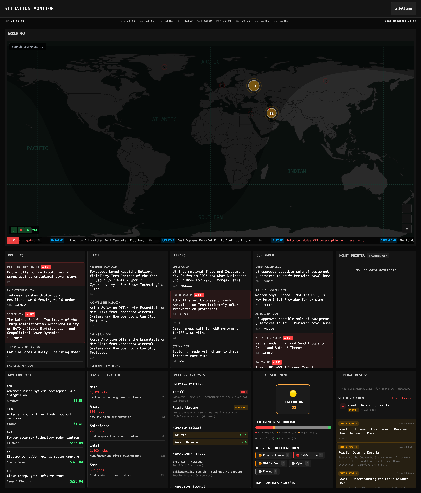

# Situation Monitor

A comprehensive real-time geopolitical intelligence platform that aggregates, analyzes, and visualizes global conflicts, developments, news, market data, and geopolitical events. This is a personal OSINT dashboard built for educational purposes, designed for analysts, researchers, traders, and anyone who needs to stay informed about world events as they unfold.



## Features

- 📰 **Multi-source News Aggregation** - Real-time news from Reuters, AP, Foreign Affairs, CSIS, Brookings, and more
- 📊 **Live Market & Commodity Data** - Stock prices, commodities, cryptocurrencies via Finnhub
- 🗺️ **Interactive Global Map** - Visual representation of conflicts and geopolitical hotspots
- ⚔️ **Real-time Conflict Tracking** - GDELT Project integration for conflict monitoring
- 🎯 **Sentiment & Narrative Analysis** - ML-powered analysis of news narratives and sentiment
- 🔔 **Custom Keyword Monitors** - Create alerts for specific topics and events
- 🌐 **World Leader Tracking** - Track statements and activities of key global figures
- 📈 **Pattern Correlation Analysis** - Discover correlations between events and market movements
- 🎲 **Prediction Markets** - Top Polymarket markets by 24h volume

## Tech Stack

- **Frontend**: SvelteKit, TypeScript, Tailwind CSS
- **Build**: Vite, PostCSS
- **Testing**: Vitest, Playwright
- **Data Sources**: 
  - GDELT Project (conflicts)
  - Finnhub (financial data)
  - CoinGecko (crypto prices)
  - Polymarket Gamma API (prediction markets)
  - Multiple news sources via proxy

## Getting Started

### Prerequisites

- Node.js 22+
- npm/pnpm

### Installation

```bash
# Clone the repository
git clone <repository-url>
cd situation-monitor

# Install dependencies
npm install

# Setup environment variables
cp .env.example .env
```

### Environment Configuration

Update `.env` with your API keys:

```env
VITE_FINNHUB_API_KEY=your_finnhub_key
```

**Getting API Keys:**
- [Finnhub](https://finnhub.io/) - Free tier available

### Development

```bash
# Start dev server
npm run dev

# Run tests
npm test

# Run end-to-end tests
npm run test:e2e

# Build for production
npm run build

# Preview production build
npm run preview
```

## Project Structure

```
src/
├── lib/
│   ├── analysis/        # Sentiment, narrative, correlation analysis
│   ├── api/            # External API integrations
│   ├── components/     # Svelte components (panels, modals, layout)
│   ├── config/         # Application configuration
│   ├── services/       # Cache, circuit breaker, deduplication
│   ├── stores/         # Svelte stores (state management)
│   ├── types/          # TypeScript type definitions
│   └── utils/          # Utility functions
└── routes/             # SvelteKit routes
```

## Key Features Explained

### Panel System
The dashboard consists of configurable panels that can be enabled/disabled and reordered:
- Global Situation map (GDELT-derived conflict hotspots, news clusters, strategic locations)
- News panels (Politics, Tech, Finance, Government)
- Markets (indices, sectors, commodities, crypto)
- Pattern Analysis and Global Sentiment
- Polymarket and Gov Contracts

### Settings
Access dashboard settings to:
- Toggle panels on/off
- Reorder panels via drag-and-drop
- Switch between light/dark themes
- Reset to default configuration

## Data Sources

- **GDELT Project** - Global conflict and event data
- **Reuters, AP, Foreign Affairs, CSIS, Brookings** - News sources
- **War on the Rocks, Bellingcat, ISW** - Specialized geopolitical analysis
- **Finnhub** - Financial market data
- Additional verified intelligence sources

## Performance Features

- **Circuit Breaker** - Prevents cascading API failures
- **Request Deduplication** - Eliminates redundant API calls
- **Response Caching** - Reduces API usage and improves responsiveness
- **Request Registry** - Tracks in-flight requests to prevent duplicates

## Testing

```bash
# Unit tests (once)
npm run test:unit

# Watch mode
npm run test

# Type checking and lint
npm run check
npm run lint

# E2E tests (requires a built preview server)
npm run test:e2e
```

## Disclaimer

⚠️ This tool is for informational purposes only. Always verify information through official sources before making decisions.


## Contributing

Contributions are welcome. Please ensure tests pass and code follows the existing style.

## Support

For issues, questions, or suggestions, please open an issue in the repository.

---

_Fork of [hipcityreg/situation-monitor](https://github.com/hipcityreg/situation-monitor)_

---

